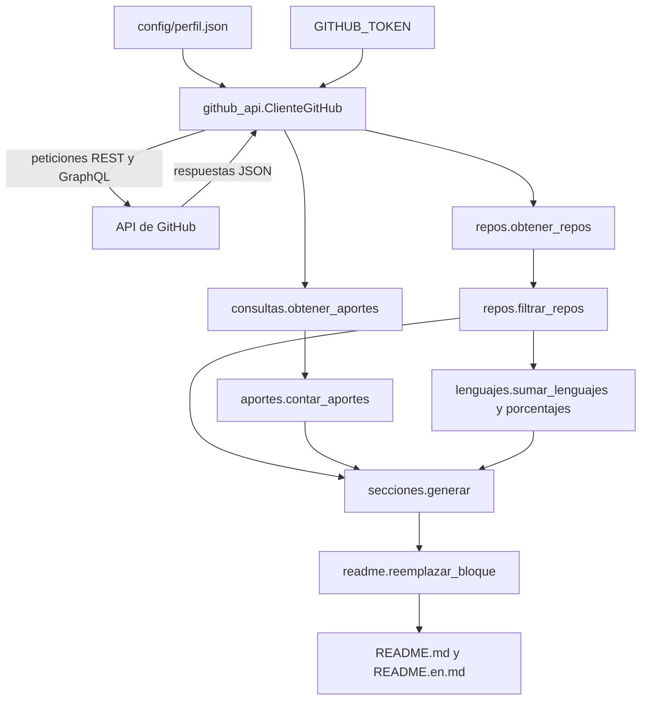

# Arquitectura de los scripts del perfil

Este documento describe cómo fluyen los datos desde la API de GitHub hasta
los bloques automáticos del README del perfil, y qué responsabilidad tiene
cada módulo de `scripts/perfil/`.

## Visión general

Los scripts están separados en cuatro capas, cada una con una
responsabilidad única:

1. **Acceso a datos**: habla con la API de GitHub.
2. **Procesamiento**: calcula sobre los datos recibidos, sin red.
3. **Generación de secciones**: convierte esos datos en Markdown.
4. **Sustitución**: reemplaza los bloques marcados del README.

La separación tiene una consecuencia práctica: solo la primera capa necesita
conexión, así que el resto se puede probar sin simular nada.

## Diagrama de flujo de datos



## Capa de acceso a datos

### `github_api.py`

Define `ClienteGitHub`, el único punto del proyecto que hace peticiones de
red. Está implementado con `urllib` de la biblioteca estándar, sin
dependencias externas.

- `rest(ruta, params=None)`: hace una petición REST. Si la respuesta es una
  lista, sigue el encabezado `Link rel="next"` y concatena todas las páginas.
- `graphql(consulta, variables=None)`: ejecuta una consulta GraphQL y
  devuelve el contenido de `data`. Lanza `RuntimeError` si la respuesta trae
  errores.

El método interno `_hacer_peticion` concentra el manejo de fallos: reintenta
hasta tres veces ante errores 5xx con espera creciente, y lanza `RuntimeError`
ante errores 4xx. El token se envía en el encabezado `Authorization` solo si
se pasó al construir el cliente.

### `consultas.py`

Contiene las consultas GraphQL del perfil y la lógica de paginación de
aportes.

- `QUERY_PRS`: pull requests en estado `MERGED` de un repositorio.
- `QUERY_COMMITS`: historial de la rama por defecto.
- `obtener_aportes(cliente, usuario, nombres_repos)`: devuelve la tupla
  `(prs, commits)`, paginando de 100 en 100.

Al recolectar commits descarta los que llegaron por un pull request, los de
fusión y los que no tienen una cuenta de GitHub vinculada.

## Capa de procesamiento

Estos módulos no llaman a la API: reciben datos y calculan.

### `repos.py`

- `obtener_repos(cliente, usuario)`: trae los repositorios públicos.
- `filtrar_repos(...)`: descarta los excluidos según la configuración.

### `aportes.py`

- `contar_aportes(...)`: cuenta los pull requests aceptados y los commits
  directos por usuario.
- `obtener_login(autor)`: extrae el login de forma segura cuando el campo
  puede venir nulo.

Las cuentas listadas en `cuentas_excluidas` no se cuentan como colaboradores.

### `lenguajes.py`

- `sumar_lenguajes(por_repo)`: suma los bytes por lenguaje de todos los
  repositorios.
- `porcentajes(totales, minimo=1.0)`: convierte esos totales a porcentajes y
  agrupa bajo `Otros` los que quedan por debajo del mínimo.

## Capa de generación de secciones

Cada módulo de `scripts/perfil/secciones/` expone una función `generar` que
devuelve el Markdown de un bloque. Ninguno accede a la red y todos reciben el
idioma, porque el perfil se publica en español e inglés.

- `cifras.py`: `calcular_cifras(repos, aportes)` y `generar(cifras, idioma)`.
  Produce la línea de insignias con los números del perfil.
- `proyectos.py`: `generar(repos, idioma)`. Arma la tabla de proyectos con
  fecha y licencia de cada repositorio.
- `colaboradores.py`: `generar(aportes, top, idioma)`. Genera la cuadrícula
  de avatares y la tabla completa de colaboradores.
- `lenguajes.py`: `generar(porcentajes, idioma)`. Crea una insignia por
  lenguaje y la tabla de porcentajes.
- `primeras_issues.py`: `generar(datos, max_items, idioma)`. Lista las issues
  recomendadas para quien recién empieza.

Todos escapan el texto antes de insertarlo, para que un nombre de repositorio
o de usuario no rompa el Markdown ni el HTML generado.

## Capa de sustitución

### `readme.py`

Es el único módulo que toca el texto del README, y solo eso: no lee ni
escribe archivos, y no usa red.

- `reemplazar_bloque(texto, nombre, contenido)`: sustituye lo que hay entre
  los marcadores de una sección y devuelve `(texto_nuevo, True)`. Si falta
  alguno de los marcadores devuelve `(texto, False)` sin cambios.

Los marcadores se construyen a partir de dos plantillas:

```python
MARCADOR_INICIO = "<!-- auto:{nombre} -->"
MARCADOR_FIN = "<!-- /auto:{nombre} -->"
```

Para la sección de lenguajes, por ejemplo, el bloque del README queda
delimitado por `<!-- auto:lenguajes -->` y `<!-- /auto:lenguajes -->`. El
contenido entre ambos se reemplaza entero y los marcadores se conservan, de
modo que el proceso puede repetirse indefinidamente.

## Configuración

`config/perfil.json` define los parámetros del proceso: el usuario de
GitHub, los repositorios y cuentas que se excluyen, el tema que marca un
repositorio como no publicable, cuántos colaboradores se muestran, cuántas
issues se listan y qué idioma corresponde a cada archivo README.

## Automatización

El flujo `.github/workflows/actualizar-perfil.yml` ejecuta el proceso todos
los días a las 06:00 UTC, y también puede dispararse a mano desde la pestaña
Actions. Si el README no cambió, no se crea ningún commit.
